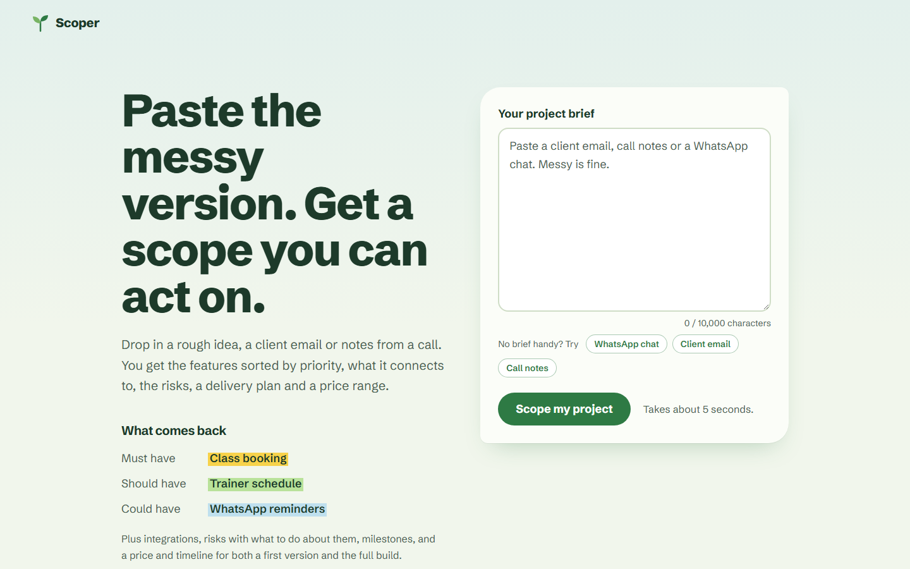
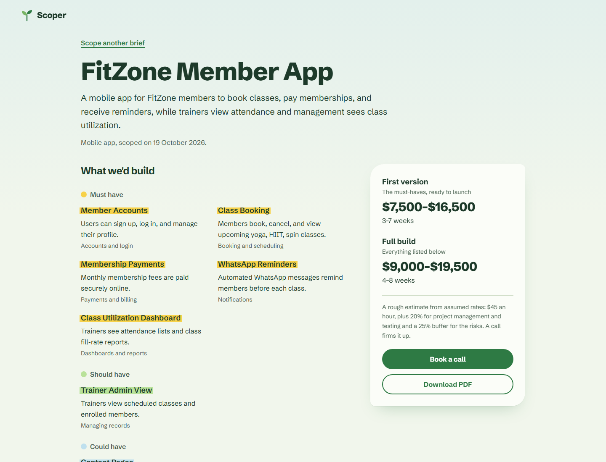
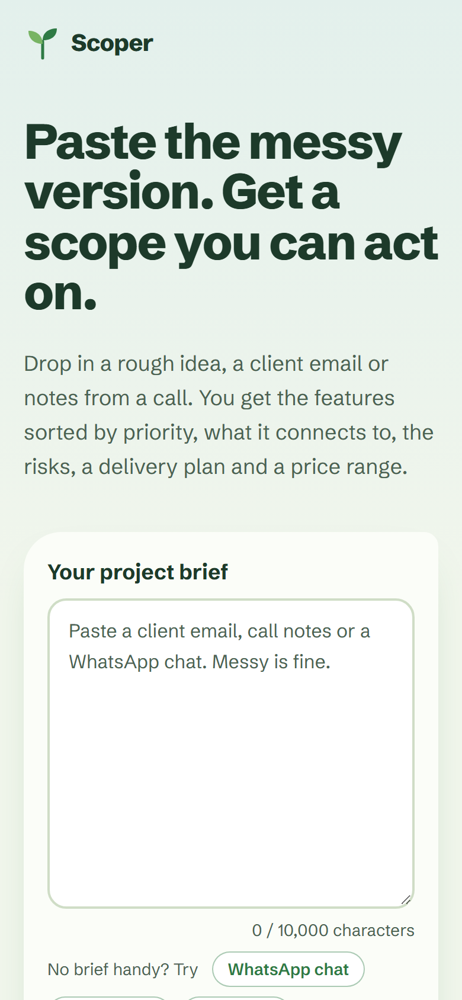
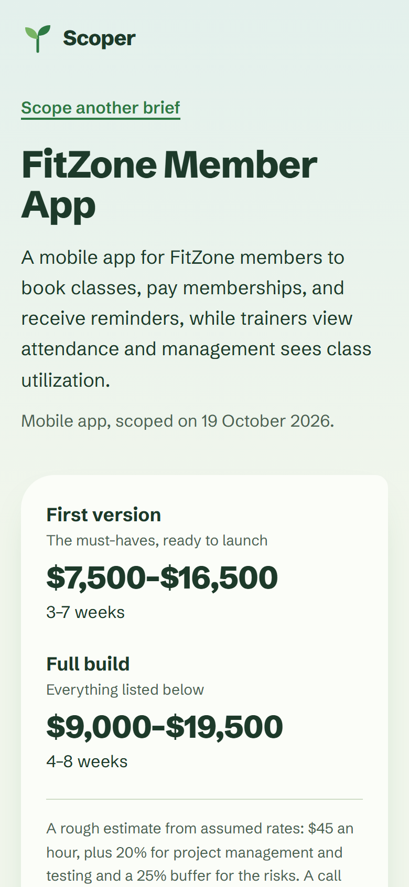
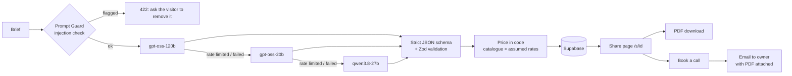

# Scoper: AI Project Scoper

Paste a rough project brief (an idea, a client email, call notes or a WhatsApp chat) and get a structured scope back:
features sorted by priority, integrations, risks, a delivery plan, and a price and timeline range for a first version
and the full build. Visitors can download the scope as a PDF or book a call, which saves the lead and emails it to the
owner with the PDF attached.

**Live:** https://aiprojectscoper.vercel.app ·
**Example scope** (from the WhatsApp sample brief): https://aiprojectscoper.vercel.app/s/afe0fd94-3462-4437-be68-0a835df8a3ac

| Home | Scope |
|------|-------|
|  |  |

<p>
  
  
</p>

## The problem

Clients rarely send a spec. They send a voice-note transcript, a forwarded email or a burst of WhatsApp messages, and
someone has to turn that into features, risks and a price before the first call. Scoper does the first pass in a few
seconds, so the call starts from a shared, written scope instead of from scratch.

## How it works



1. **Screen the brief.** Groq's `llama-prompt-guard-2` scores it for prompt-injection attempts. A brief that tries to
   instruct the model is rejected with a clear message; if the guard is down, scoping continues (losing a lead is worse).
2. **Generate with a model chain.** Three Groq models in strict JSON-schema mode. When one hits its rate limit it cools
   down for Groq's `retry-after` and the next model answers at once. Output is validated again with Zod; a scope with no
   must-have features or an implausible feature count is rejected and the next model tries.
3. **Price in code, not by the model.** The model only classifies each feature into a fixed catalogue (booking,
   checkout, payments, AI assistant, …). Hours per type live in `src/lib/pricing/config.ts`. That made prices
   consistent across models: asking models for "small/medium/large" sizes gave the same brief prices up to 2.8× apart.
4. **Store, share, follow up.** Each scope gets an unguessable share link, a cached server-rendered PDF, and a
   "Book a call" form that emails the owner with the PDF attached and reply-to set to the visitor.

## Numbers

| What | Result |
|------|--------|
| Lighthouse, home (mobile / desktop) | Performance 97 / 100 · Accessibility 100 · Best practices 100 · SEO 100 |
| Lighthouse, scope page (mobile / desktop) | Performance 98 / 98 · Accessibility 100 · Best practices 100 · SEO 90 |
| Layout shift (CLS) | 0 on every page |
| Scope generation (eval, 9 briefs) | p50 2.6 s, p95 3.4 s; production end to end about 5 s |
| Cost per scope | about $0.0012 at Groq list prices |
| Price consistency across models | same-brief spread: median 1.85× → 1.46×, worst 2.84× → 1.69× after switching to the catalogue |
| Tests | 105 unit · 11 integration (real database) · 36 end-to-end (Playwright, desktop and mobile, axe accessibility scans) |

## Security and privacy

- The browser never talks to the database. Tables have RLS on and no public grants; tests assert the public key gets
  "permission denied" on every table.
- APIs accept JSON only, with a size cap, which blocks cross-site form posts; lead names can't carry email-header injection.
- Visitor IPs are stored only as salted hashes for rate limiting, and a nightly job deletes them after a day.
- Scope pages and PDFs send `X-Robots-Tag: noindex, nofollow`, so private briefs stay out of search engines.
- Secrets live in environment variables only; the client bundle is scanned for them in review.

## Stack

Next.js 16 (App Router, Cache Components) · TypeScript · Tailwind CSS 4 · Zod · Groq · Supabase (Postgres, RLS, pg_cron) ·
@react-pdf/renderer · Resend · Vercel (functions in Seoul, next to the database) · Vitest · Playwright

## Getting started

```bash
npm install
cp .env.example .env.local   # then fill in the keys (see below)
npm run dev                  # http://localhost:3000
```

| Variable | Purpose |
|----------|---------|
| `GROQ_API_KEY` | Groq API key for scope generation and the injection guard |
| `SUPABASE_URL`, `SUPABASE_SECRET_KEY` | Server-side database access (the secret key never reaches the browser) |
| `SUPABASE_PUBLISHABLE_KEY` | Only used by the integration tests, to prove the public API can't read the tables |
| `IP_HASH_SALT` | Random string; visitor IPs are stored only as salted hashes |
| `RESEND_API_KEY`, `RESEND_FROM`, `LEAD_NOTIFY_EMAIL` | Lead notification emails |
| `APP_URL` | Public base URL for links in emails and PDFs |
| `SCOPER_FAKE_LLM=1`, `SCOPER_FAKE_EMAIL=1` | Run without Groq quota or real email (used by e2e tests) |

Database schema: `supabase/migrations/` (apply with `npx supabase db push --linked`).
In VS Code, press F5 and pick **Run Scoper** or **Run Scoper (fake AI + email)**.

## Scripts

| Command | What it does |
|---------|--------------|
| `npm run dev` | Development server |
| `npm test` | Unit tests (Vitest) |
| `npm run test:integration` | Tests against the real Supabase project in `.env.local` |
| `npm run e2e` | Browser tests (Playwright) against a production build, with fake AI and email |
| `npm run eval` | Runs the sample briefs in `evals/briefs/` through the real model chain (uses Groq quota) |
| `npm run compare` | Measures how consistently the three models price the same brief (uses Groq quota) |
| `npm run typecheck`, `npm run lint` | Type and lint checks |

## Project notes

`memory.md` records every decision, measurement and gotcha from the build; `docs/plan.md` is the original plan.
Prices are based on assumed rates until real project data replaces them.
